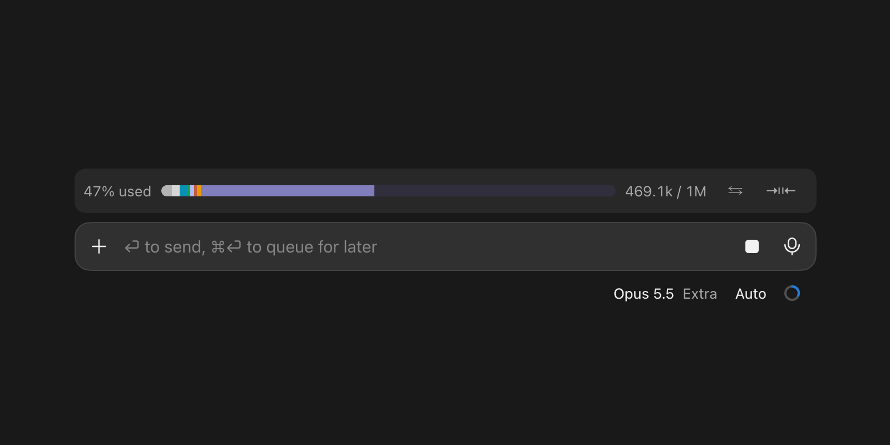

# context-bar

A Claude Code mod that puts a full-width context window bar above the prompt:



- **The bar** splits what's in the context window by category (messages, system prompt, tools, memory files, skills), in the colors `/context` uses, and stretches to the width of the window.
- **The numbers** are the status line's own: percent used, then tokens used out of the model's window. The percent turns yellow at 75% and red at 90%. Right after a compaction it shows a `~` estimate until the next response comes back.
- **⇆ (handoff)** runs `/handoff`, or `/handoff-resume` if a handoff was the last thing run in the session. A typical cycle: ⇆ writes a handoff, ⇥⇤ compacts, and the next ⇆ resumes from it.
- **⇥⇤ (compact)** runs `/compact`.

Both buttons ask before they run anything. A click during a turn runs its command once the turn ends.

## Install

At the prompt of a Claude Code terminal session:

```
/plugin install context-bar --marketplace alisorcorp/context-bar
```

Answer `y` to add the marketplace, then pick a scope (user scope loads it in every session). In the desktop app, click **+** next to the prompt box, then **Plugins**, **Add marketplace** with `alisorcorp/context-bar`, then **Add plugin**.

Built and tested on Claude Code 2.1.325. The mod API it uses is in early access and may change between releases.

## The handoff commands

The mod ships two slash commands. As plugin commands their full names are `/context-bar:handoff` and `/context-bar:handoff-resume`; the short names work as long as no other command claims them.

- **`/handoff [focus]`** writes `HANDOFF.md` to the project root: goal, what's done, what isn't, failed approaches, key decisions, current state, and resume steps. It re-runs every volatile fact (SHAs, test counts, versions) rather than recalling it, audits the file before finishing, and prints a one-line audit result. Run it before `/compact`, or before you step away.
- **`/handoff-resume [path]`** reads the handoff, checks for drift since it was written (new commits, a changed working tree), gives a short read-out, and continues from the first resume step once you say go. Right after a compaction it continues without waiting.

Both work outside git repositories too, minus the git checks.

### Optional: warrant

With [warrant](https://github.com/alisorcorp/warrant) installed, `/handoff` attaches a re-runnable check to each claim a shell command can verify (`<!-- warrant: run="git rev-parse --short HEAD" contains="a1b2c3d" -->`), runs them all before finishing, and saves a receipt. `/handoff-resume` re-runs them and reports what went `STALE` since the handoff was written. Without warrant, both commands skip those steps and audit by hand.

```bash
uv tool install git+https://github.com/alisorcorp/warrant
```

warrant runs shell commands written in a document. `/handoff-resume` always lists them with `--dry-run` first, and asks before running any that aren't read-only, so be especially careful with a handoff someone else committed.

## Settings

Two settings choose what ⇆ runs. They show up as rows in `/config`, and on the setup screen when you install.

| Setting | Default | What it does |
|---|---|---|
| Handoff command | `handoff` | What ⇆ runs first, without the slash. Name your own command to use it instead. Leave it empty to hide ⇆. |
| Resume command | `handoff-resume` | What ⇆ runs right after a handoff. Leave it empty, or name a command that isn't installed, and ⇆ always runs the handoff command. |

⇆ hides itself when the handoff command isn't installed, and checks again after every turn.

## Limits

- On the desktop app the bar is drawn as an SVG with fixed dark-mode colors, so it won't follow a light theme. The terminal draws it with your theme's colors.
- The buttons are text glyphs: a mod's buttons can hold only text, not icons.
- The app owns the band's padding, so the mod can't set the band's exact height.
- Which handoff command ran last is remembered per session.

## Development

```bash
claude plugin test .       # the tests in tests/
claude plugin validate .   # manifest, hooks module, commands
claude --plugin-dir .      # run a session with this folder loaded
```

## License

MIT
